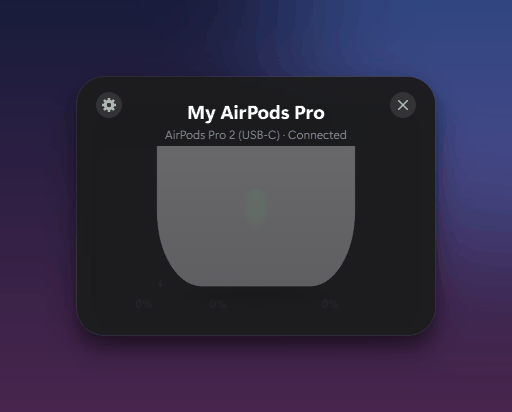
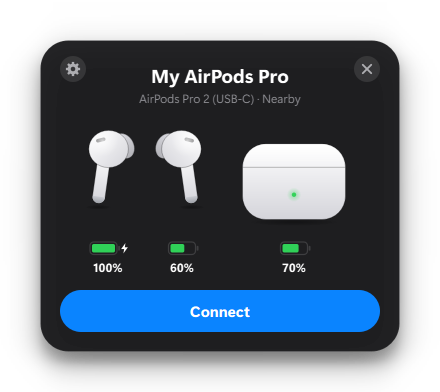
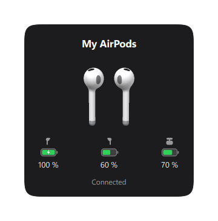
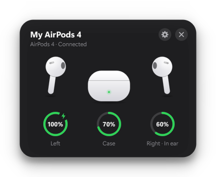
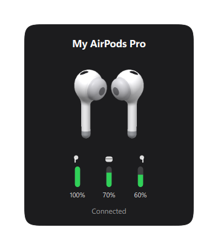
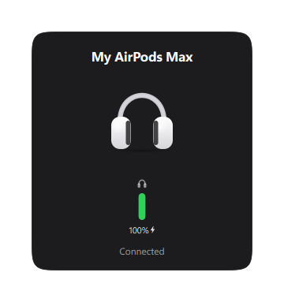
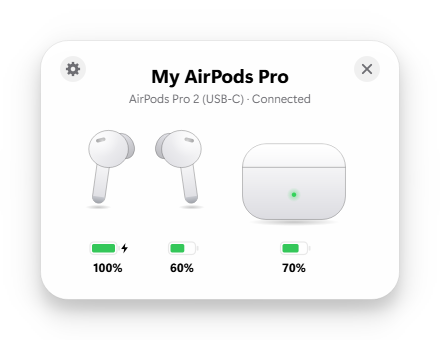

<h1 align="center">PodPop</h1>

<p align="center">
  <b>The iPhone AirPods popup, on Windows.</b><br>
  Open the case and a card slides up with live battery for each bud and the case,<br>
  then connects your AirPods to the PC automatically.
</p>

<p align="center">
  <a href="../../releases/latest"></a>
</p>

<p align="center">
  <a href="https://github.com/karimdc5/Airpods-Popup-Windows-PC-/actions/workflows/ci.yml"></a>
  
  
  
  
</p>

<p align="center">
  
</p>

## Why PodPop?

There are a few AirPods tools for Windows.
[AirPodsDesktop](https://github.com/SpriteOvO/AirPodsDesktop) is the best known,
and PodPop's protocol work was cross-checked against it. PodPop focuses on
doing everything **automatically and reliably**:

- It **connects when you open the case**, even taking the AirPods over from your iPhone.
- It **hands them back to your phone when you lock the PC** and takes them again when you unlock.
- It **fixes Windows' "connected but no sound" bug** after you walk away and come back.
- It **pauses your music** when you take a bud out and resumes when you put it back.
- It **learns your buds' real battery life** to show how much listening time is left.

## Download and install

1. Go to the [**latest release**](../../releases/latest) and download **`PodPop.exe`**.
2. Double-click it. There's nothing to install and you don't need Python.
3. PodPop goes in the system tray (the **^** next to the clock) and starts by
   itself every time you sign in.

> **Windows SmartScreen says "Windows protected your PC"?** The exe isn't
> code-signed, which costs money for a hobby project. Click **More info →
> Run anyway**. You can also [build it yourself](#build-from-source) from this source.

**Requirements:** Windows 10 or 11 with Bluetooth, and AirPods (or Beats)
already paired in *Settings → Bluetooth & devices*.

## Features



- **Pops up when you open the case**, and when the AirPods connect. Click the
  tray icon to see it any time.
- **Connects automatically** when you open the case, even if the AirPods were
  on your iPhone. There's also a one-click **Connect** button.
- **Hand-off to your phone.** Lock the PC (<kbd>Win</kbd>+<kbd>L</kbd>) while
  wearing your AirPods and walk away: PodPop lets go of them so your iPhone
  can take over. Unlock while wearing them and they come back to the PC. It
  never cuts off music that's playing on the PC.
- **Battery for left, right and case**, plus charging state and **in-ear**
  detection.
- **Battery time left** ("About 3h 40m left"). It starts from Apple's rated
  listening time, then learns how fast your own buds drain.
- **Auto pause/resume.** Take an AirPod out and your music or video pauses.
  Put it back in and playback resumes.
- **Stuck-audio fix.** Windows sometimes shows the AirPods as connected but
  plays nothing after you walk away and come back. PodPop notices and reopens
  the audio link.
- **Low-battery alerts** at 20% and 10%.
- **Artwork for each model**: AirPods 1–4, Pro, Pro 2 and Max, plus Beats.
  Light and dark themes, and an opening animation where the lid opens and
  the buds glide out.
- **Global hotkeys:** <kbd>Ctrl</kbd>+<kbd>Alt</kbd>+<kbd>A</kbd> shows the
  battery, and <kbd>Ctrl</kbd>+<kbd>Alt</kbd>+<kbd>C</kbd> connects or fixes
  audio.
- **Settings window** (⚙ on the popup, or right-click the tray icon). Every
  feature above can be switched on or off, and changes apply immediately.

<br clear="right">

### Works with every model

<table>
  <tr>
    <td align="center"><br><sub>AirPods (1st/2nd gen)</sub></td>
    <td align="center"><br><sub>AirPods 3 / 4</sub></td>
  </tr>
  <tr>
    <td align="center"><br><sub>AirPods Pro / Pro 2</sub></td>
    <td align="center"><br><sub>AirPods Max</sub></td>
  </tr>
  <tr>
    <td align="center" colspan="2"><br><sub>Light mode</sub></td>
  </tr>
</table>

## How it works

AirPods constantly broadcast a small Bluetooth LE "Proximity Pairing" message.
It's the same one an iPhone reads to show its popup, and the battery and
lid/in-ear fields aren't encrypted. PodPop listens through Windows' own BLE
stack with [bleak](https://github.com/hbldh/bleak) and decodes those bytes.
Connect and disconnect events come from a WinRT `DeviceWatcher`, and the
audio connection goes through the Windows Core Audio COM APIs.

**📖 Byte-by-byte write-up: [How PodPop reads your AirPods](docs/protocol.md)**,
covering the packet layout, a decoded real capture, and the quirks (buds that
lie about each other, rotating addresses, a case that goes quiet when closed).

```
 BLE adverts ──► ble.py ──► protocol.py ──► state.Tracker ──┐
   (thread)       decode     (pure)        merge, pick       ├─► presenter ──► popup / tray
 WinRT watcher ─► connection.py ────────────────────────────┘     (pure)        (Qt)
```

| Module | Role |
|---|---|
| `protocol.py` | Decodes the advert bytes. Pure and unit-tested against real packets. |
| `catalog.py` | Model IDs, names and product family (which picks the artwork). |
| `state.py` | Merges adverts from both buds, tracks freshness, filters out strangers' AirPods by signal strength, and detects the case opening. |
| `presenter.py` | Turns state into what the UI shows. |
| `runtime.py` | Estimates the listening time left from the observed drain rate. |
| `ble.py` / `connection.py` | Windows services on background threads, with retry and a watchdog. |
| `audio_connect.py` | Connects, disconnects and checks whether audio is active for a paired headset. |
| `doctor.py` | Decides when a stuck link needs a reconnect. Pure and tested. |
| `ear.py` / `media.py` | In-ear changes → pause/resume through Windows media sessions. |
| `handoff.py` / `session.py` | Releases the AirPods when the PC locks and takes them back on unlock. Pure and tested. |
| `autostart.py` | Start at sign-in through a per-user Task Scheduler task. |
| `ui/` | Popup card, vector artwork, opening animation, tray icon, settings window. |
| `app.py` | Wires everything together on the Qt thread. |

### What AirPods don't broadcast
- Battery comes in **10% steps**. Exact percentages and noise-control modes
  need Apple's private L2CAP protocol, which Windows doesn't expose to apps.
- The case battery is only known while at least one bud is inside it.
- Someone else's AirPods of the same model nearby can show up. Raise the
  *Signal threshold* in Settings (for example to −65 dBm) if that happens.

## Build from source

```powershell
git clone https://github.com/karimdc5/Airpods-Popup-Windows-PC-.git
cd Airpods-Popup-Windows-PC-
python -m venv .venv
.\.venv\Scripts\pip install -e ".[dev]"

.\.venv\Scripts\pythonw -m podpop                 # run the tray app
.\.venv\Scripts\python -m pytest                  # run the tests
.\scripts\build.ps1                               # build dist\PodPop.exe
```

Handy for development:

```powershell
.\.venv\Scripts\python -m podpop --demo pro --theme light   # popup with sample data, no AirPods needed
.\.venv\Scripts\python -m podpop --demo pro --nearby        # the "Connect" state
.\.venv\Scripts\python -m podpop --sniff                    # print decoded adverts live
.\.venv\Scripts\python -m podpop --debug                    # verbose logging
.\.venv\Scripts\python scripts\make_demo_gif.py             # re-record docs/images/demo.gif
```

Settings are stored in `%APPDATA%\PodPop\settings.json` and logs in
`%LOCALAPPDATA%\PodPop\logs`.

## Uninstall
Right-click the tray icon → **Settings** → untick **Start with Windows**, quit
PodPop, then delete `PodPop.exe`. To remove its data too, delete
`%APPDATA%\PodPop` and `%LOCALAPPDATA%\PodPop`.

## Roadmap
- [x] Auto play/pause when a bud is taken out
- [x] Settings window
- [x] Global hotkeys
- [x] Automatic connect when the case opens
- [x] Hand-off to your phone when the PC locks
- [ ] Artwork in each AirPods color (the color byte is already decoded)

Issues and pull requests are welcome.

## Credits
The protocol layout was cross-checked against
[AirPodsDesktop](https://github.com/SpriteOvO/AirPodsDesktop) (GPL-3.0; no
code copied), OpenPods, and furiousMAC's Continuity research.

## License
[MIT](LICENSE). PodPop is an independent project and isn't affiliated with or
endorsed by Apple Inc. AirPods and Beats are trademarks of Apple Inc.
