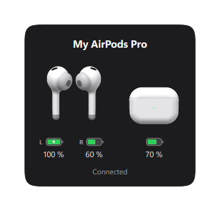
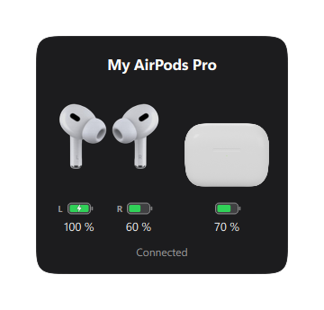

<h1 align="center">PodPop</h1>

<p align="center">
  <b>The iPhone AirPods popup, on Windows.</b><br>
  Open the case and a card slides up with live battery for each bud and the case,<br>
  then connects your AirPods to the PC automatically.
</p>

<p align="center">
  <a href="../../releases/latest"></a>
</p>

<p align="center">
  <a href="https://github.com/karimdc5/Airpods-Popup-Windows-PC-/actions/workflows/ci.yml"></a>
  
  
  
  
</p>

<p align="center">
  <br>
  <sub>Shown with <a href="#use-your-own-hud-artwork">your own AirPods artwork</a> installed. Out of the box, PodPop draws its own 3D AirPods.</sub>
</p>

## Why PodPop?

There are a few AirPods tools for Windows.
[AirPodsDesktop](https://github.com/SpriteOvO/AirPodsDesktop) is the best known,
and PodPop's protocol work was cross-checked against it. PodPop focuses on
doing everything **automatically and reliably**:

- It **connects when you open the case**, even taking the AirPods over from your iPhone.
- It **hands them to your phone when you step away from the PC** while wearing them.
- It **fixes Windows' "connected but no sound" bug** after you walk away and come back.
- It **pauses your music** when you take a bud out and resumes when you put it back.
- It **learns your buds' real battery life** to show how much listening time is left.

## Download and install

1. Go to the [**latest release**](../../releases/latest) and download **`PodPop.exe`**.
2. Double-click it. There's nothing to install and you don't need Python.
3. PodPop goes in the system tray (the **^** next to the clock) and starts by
   itself every time you sign in.

> **Windows SmartScreen says "Windows protected your PC"?** The exe isn't
> code-signed, which costs money for a hobby project. Click **More info →
> Run anyway**. You can also [build it yourself](#build-from-source) from this source.

**Requirements:** Windows 10 or 11 with Bluetooth, and AirPods (or Beats)
already paired in *Settings → Bluetooth & devices*.

## Features


- **Pops up when you open the case**, and when the AirPods connect. Click the
  tray icon to see it any time.
- **Connects automatically** when you open the case, even if the AirPods were
  on your iPhone. When the popup says *Not connected*, one click on it connects
  them.
- **Hand-off to your phone.** Walk away from the PC wearing your AirPods,
  and after 2 minutes without keyboard or mouse input PodPop lets go of them
  so your iPhone can take over. Back at the PC, the popup appears, and one
  click on it brings them back.
  It never cuts off music that's playing on the PC. Or press
  <kbd>Ctrl</kbd>+<kbd>Alt</kbd>+<kbd>P</kbd> to hand them over right away.
- **Battery for left, right and case**, plus charging state and **in-ear**
  detection.
- **Battery time left** ("About 3h 40m left"). It starts from Apple's rated
  listening time, then learns how fast your own buds drain.
- **Auto pause/resume.** Take an AirPod out and your music or video pauses.
  Put it back in and playback resumes.
- **Stuck-audio fix.** Windows sometimes shows the AirPods as connected but
  plays nothing after you walk away and come back. PodPop notices and reopens
  the audio link.
- **Low-battery alerts** at 20% and 10%.
- **An iOS-style battery popup**: a frosted dark card just above the taskbar.
  The AirPods turn once and then hold still, with the case beside them. Each
  has its battery underneath, iOS style: one for the AirPods (L and R
  separately when they differ), one for the case, a bolt while charging,
  yellow at 20% and red at 10%. It stays a few seconds after the turn, then
  fades out. Works with AirPods 1–4, Pro, Pro 2 and Max, plus Beats. The 3D
  models are PodPop's own, rendered by [`scripts/render_turntable.py`](scripts/render_turntable.py),
  and you can [use your own artwork](#use-your-own-hud-artwork) instead (see the before and after).
- **Global hotkeys:** <kbd>Ctrl</kbd>+<kbd>Alt</kbd>+<kbd>A</kbd> shows the
  battery, <kbd>Ctrl</kbd>+<kbd>Alt</kbd>+<kbd>C</kbd> connects or fixes
  audio, and <kbd>Ctrl</kbd>+<kbd>Alt</kbd>+<kbd>P</kbd> hands the AirPods to
  your phone.
- **Settings window** (right-click the tray icon → Settings). Every feature
  above can be switched on or off, and changes apply immediately.

<br clear="right">

### Works with every model

Out of the box, with PodPop's own 3D artwork:

<table>
  <tr>
    <td align="center"><br><sub>AirPods (1st/2nd gen)</sub></td>
    <td align="center"><br><sub>AirPods 3 / 4</sub></td>
  </tr>
  <tr>
    <td align="center"><br><sub>AirPods Pro / Pro 2</sub></td>
    <td align="center"><br><sub>AirPods Max</sub></td>
  </tr>
</table>

## How it works

AirPods constantly broadcast a small Bluetooth LE "Proximity Pairing" message.
It's the same one an iPhone reads to show its popup, and the battery and
lid/in-ear fields aren't encrypted. PodPop listens through Windows' own BLE
stack with [bleak](https://github.com/hbldh/bleak) and decodes those bytes.
Connect and disconnect events come from a WinRT `DeviceWatcher`, and the
audio connection goes through the Windows Core Audio COM APIs.

**📖 Byte-by-byte write-up: [How PodPop reads your AirPods](docs/protocol.md)**,
covering the packet layout, a decoded real capture, and the quirks (buds that
lie about each other, rotating addresses, a case that goes quiet when closed).

```
 BLE adverts ──► ble.py ──► protocol.py ──► state.Tracker ──┐
   (thread)       decode     (pure)        merge, pick       ├─► presenter ──► popup / tray
 WinRT watcher ─► connection.py ────────────────────────────┘     (pure)        (Qt)
```

| Module | Role |
|---|---|
| `protocol.py` | Decodes the advert bytes. Pure and unit-tested against real packets. |
| `catalog.py` | Model IDs, names and product family (which picks the artwork). |
| `state.py` | Merges adverts from both buds, tracks freshness, filters out strangers' AirPods by signal strength, and detects the case opening. |
| `presenter.py` | Turns state into what the UI shows. |
| `runtime.py` | Estimates the listening time left from the observed drain rate. |
| `ble.py` / `connection.py` | Windows services on background threads, with retry and a watchdog. |
| `audio_connect.py` | Connects, disconnects and checks whether audio is active for a paired headset. |
| `doctor.py` | Decides when a stuck link needs a reconnect. Pure and tested. |
| `ear.py` / `media.py` | In-ear changes → pause/resume through Windows media sessions. |
| `handoff.py` / `idle.py` | Releases the AirPods to your phone when you step away from the PC. Pure and tested. |
| `autostart.py` | Start at sign-in through a per-user Task Scheduler task. |
| `ui/` | The popup card (`popup.py`), finding your own artwork (`hud.py`), PodPop's 3D frames (`turntable.py`), vector artwork for AirPods Max and the tray icon, the settings window. |
| `scripts/render_turntable.py` | Models the AirPods and cases as signed distance fields and ray-marches the 3D frames with numpy. |
| `scripts/import_hud.py` | Installs your own artwork: converts animated PNG spins to WebP, copies stills and cases, and (with `--fetch`) gets the case symbols via `fetch_symbols.py` and draws them with `render_case.py`. |
| `app.py` | Wires everything together on the Qt thread. |

### What AirPods don't broadcast
- Battery comes in **10% steps**. Exact percentages and noise-control modes
  need Apple's private L2CAP protocol, which Windows doesn't expose to apps.
- The case battery is only known while at least one bud is inside it.
- Someone else's AirPods of the same model nearby can show up. Raise the
  *Signal threshold* in Settings (for example to −65 dBm) if that happens.

## Build from source

```powershell
git clone https://github.com/karimdc5/Airpods-Popup-Windows-PC-.git
cd Airpods-Popup-Windows-PC-
python -m venv .venv
.\.venv\Scripts\pip install -e ".[dev]"

.\.venv\Scripts\pythonw -m podpop                 # run the tray app
.\.venv\Scripts\python -m pytest                  # run the tests
.\scripts\build.ps1                               # build dist\PodPop.exe
```

Handy for development:

```powershell
.\.venv\Scripts\python -m podpop --demo pro                 # popup with sample data, no AirPods needed
.\.venv\Scripts\python -m podpop --demo pro --nearby        # the "Connect" state
.\.venv\Scripts\python -m podpop --sniff                    # print decoded adverts live
.\.venv\Scripts\python -m podpop --debug                    # verbose logging
.\.venv\Scripts\python scripts\make_demo_gif.py             # re-record docs/images/demo.gif
.\.venv\Scripts\python scripts\render_turntable.py          # re-render the 3D frames (needs numpy)
```

Settings are stored in `%APPDATA%\PodPop\settings.json` and logs in
`%LOCALAPPDATA%\PodPop\logs`.

## Use your own HUD artwork

Out of the box, the popup shows PodPop's own 3D-rendered AirPods. If you have
Apple's AirPods artwork for personal use, PodPop can show that instead. Only
the buds change; everything else on the card stays the same:

<table>
  <tr>
    <td align="center"><br><sub><b>Before:</b> PodPop's own 3D buds (what everyone gets)</sub></td>
    <td align="center"><br><sub><b>After:</b> with your own artwork installed</sub></td>
  </tr>
</table>

PodPop doesn't include Apple's artwork, because it isn't PodPop's to give
away, so you need to supply the files yourself.

### 1. Get the files

For each model you want, you need two images, named exactly like this:

| Your AirPods | Spin (one full turn, played once) | Still (the pose afterwards) |
|---|---|---|
| AirPods (1st / 2nd generation) | `airpods_spin.png` | `airpods_still.png` |
| AirPods (3rd generation) | `airpodsGen3_spin.png` | `airpodsGen3_still.png` |
| AirPods 4, 4 ANC, 5 | `airpodsGen4_spin.png` | `airpodsGen4_still.png` |
| AirPods Pro, Pro 2 | `airpodsPro_spin.png` | `airpodsPro_still.png` |
| AirPods Pro 3 | `airpodsPro3_spin.png` | `airpodsPro3_still.png` |
| AirPods Max | `airpodsMax_spin.png` | `airpodsMax_still.png` |
| Beats Solo | `beatssolo_spin.png` | `beatssolo_still.png` |
| Beats Studio, Studio Buds, Fit Pro | `beatsstudio_spin.png` | `beatsstudio_still.png` |

- The **spin** is an animated PNG (APNG) of the AirPods turning once, on a
  transparent background. It plays once when the popup appears.
- The **still** is a single transparent PNG of the AirPods facing front. It's
  shown after the spin, and it's optional: without it, the spin's last frame
  stays up.
- Any model you don't add keeps PodPop's own 3D buds.

Put all your files in one folder, for example `C:\AirPods art`.

### 2. Install them (one command)

The installer script needs Python, because it converts the animated PNGs into
a format the popup can play. One-time setup:

1. Install [Python 3.11 or newer](https://www.python.org/downloads/). In the
   installer, tick **Add python.exe to PATH**.
2. Download this project: **Code → Download ZIP** at the top of this page,
   then unzip it.
3. Open PowerShell in the unzipped folder (in File Explorer, click the
   address bar, type `powershell` and press Enter) and run:

   ```powershell
   python -m venv .venv
   .\.venv\Scripts\pip install -e ".[dev]"
   ```

Then install your artwork:

```powershell
.\.venv\Scripts\python scripts\import_hud.py "C:\AirPods art" --fetch
```

It lists every file as it goes, for example
`airpodsPro_spin.png: 180 frames, 5.9 s -> airpodsPro_spin.webp`. Everything
goes into `%APPDATA%\PodPop\hud\`, PodPop's private folder on your PC.

### 3. Restart PodPop

Right-click the tray icon, choose **Quit PodPop**, then start PodPop again.
Press <kbd>Ctrl</kbd>+<kbd>Alt</kbd>+<kbd>A</kbd> to see the popup with your
artwork.

**To undo it,** delete the folder `%APPDATA%\PodPop\hud` and restart PodPop.

<details>
<summary>Details for the curious</summary>

- The popup plays animated WebP or GIF, not animated PNG, so the script
  converts each spin to lossless WebP with the same frames and timing. If
  your spins are already WebP, you can skip the script and copy them straight
  into `%APPDATA%\PodPop\hud\` as `<name>_spin.webp`.
- The case beside the buds is PodPop's own 3D render for every model. A
  `<name>_case.png` in the same folder is only used for models without one.
- `--fetch` downloads [SF Symbols](https://developer.apple.com/sf-symbols/)
  case outlines, exported by
  [brendanballon/sfsymbols-svg](https://github.com/brendanballon/sfsymbols-svg),
  from a pinned commit. They're the fallback case picture for models without a
  3D case. They're Apple's, under Apple's SF Symbols licence, so they aren't
  included here; they're downloaded to your machine into
  [`src/podpop/assets/symbols/`](src/podpop/assets/symbols/README.md). That
  folder and the PNGs rendered from it are git-ignored.

</details>

## Uninstall
Right-click the tray icon → **Settings** → untick **Start with Windows**, quit
PodPop, then delete `PodPop.exe`. To remove its data too, delete
`%APPDATA%\PodPop` and `%LOCALAPPDATA%\PodPop`.

## Roadmap
- [x] Auto play/pause when a bud is taken out
- [x] Settings window
- [x] Global hotkeys
- [x] Automatic connect when the case opens
- [x] Hand-off to your phone when you step away
- [ ] Recognise AirPods Pro 3 and AirPods 5 (their model IDs aren't in the catalog yet, so they use the AirPods 4 artwork)
- [ ] Artwork in each AirPods color (the color byte is already decoded)

Issues and pull requests are welcome.

## Credits
The protocol layout was cross-checked against
[AirPodsDesktop](https://github.com/SpriteOvO/AirPodsDesktop) (GPL-3.0; no
code copied), OpenPods, and furiousMAC's Continuity research.

## License
[MIT](LICENSE). PodPop is an independent project and isn't affiliated with or
endorsed by Apple Inc. AirPods and Beats are trademarks of Apple Inc.
